[github](https://github.com/Aruneshw) &nbsp;·&nbsp;
[linkedin](https://www.linkedin.com/in/aruneshwaran-k/) &nbsp;·&nbsp;
[email](mailto:aruneshownsty1@gmail.com)

> AI & ML student at Bannari Amman Institute of Technology (BIT), Sathyamangalam. 
> Sharp tools over big vague ideas.

I build autonomous agents, offensive-security frameworks, and production-grade AI systems. Right now that's 
[AntiGravity](https://github.com/Aruneshw/c2-orchestration) — a fully autonomous, multi-agent Active Directory red team framework 
running on local LLMs with LangGraph orchestration. Also deep into RAG pipelines, 
phishing detection, and browser-based AI tools.

Founder · [Zero Gravity](https://github.com/Aruneshw/Zero_Gravity) (StartupTN ID: STN95825) · IEEE Student Chapter

 
 

<samp>python &nbsp; typescript &nbsp; javascript &nbsp; kotlin &nbsp; react &nbsp; node &nbsp; langchain &nbsp; langgraph &nbsp; ollama &nbsp; fastapi &nbsp; docker &nbsp; neo4j &nbsp; postgres &nbsp; redis &nbsp; git &nbsp; linux</samp>

**[bit-librarary](https://github.com/Aruneshw/bit-librarary)** &nbsp;·&nbsp; <samp>typescript, next.js</samp> 
Enterprise-grade multi-framework library platform with NGINX load balancing, 
TLS tunneling, and Vue/Solid.js support. Full-stack Next.js architecture.

**[bit-ieee](https://github.com/Aruneshw/bit-ieee)** &nbsp;·&nbsp; <samp>typescript, next.js</samp> 
IEEE Student Chapter hub for BIT Sathyamangalam. Arduino sketch compiler, 
AI-driven circuit grading service, and event management platform.

**[AntiGravity](https://github.com/Aruneshw/c2-orchestration)** &nbsp;·&nbsp; <samp>python, langgraph, docker</samp> 
Autonomous multi-agent AD red team framework. Six LLM agents orchestrated 
through LangGraph with MCP tooling, ROE enforcement, and sandboxed container isolation.

**[OCR-EXTRACTOR](https://github.com/Aruneshw/OCR-EXTRACTOR)** &nbsp;·&nbsp; <samp>typescript, tesseract.js</samp> 
Browser-based optical character recognition with drag-and-drop interface, 
multi-language support, and live text extraction preview.

**[Zero_Gravity](https://github.com/Aruneshw/Zero_Gravity)** &nbsp;·&nbsp; <samp>html, css, javascript</samp> 
Community-driven tech freelance ecosystem connecting clients with student developers 
through a competitive Problem Hub model.

**[LIFEOS](https://github.com/Aruneshw/LIFEOS)** &nbsp;·&nbsp; <samp>kotlin</samp> 
Personal life operating system — native Android app for productivity, 
habit tracking, and task orchestration.

**[ai_app](https://github.com/Aruneshw/ai_app)** &nbsp;·&nbsp; <samp>kotlin</samp> 
AI-powered mobile application built with Kotlin for intelligent 
on-device processing and LLM integration.

**[TRAVELOOP](https://github.com/Aruneshw/TRAVELOOP)** &nbsp;·&nbsp; <samp>hackathon</samp> 
Travel platform built at OODO Hackathon. Route optimization 
and trip planning with collaborative features.

Every graphic here is generated, not embedded from anyone else's server. 
`ascii.svg` is a photo pushed through a character ramp (`.` `:` `-` `=` `+` `*` `#` `%` `@`) 
using a Python script and PIL. The section headings and stat graphics use 
SMIL animations inside SVGs — because GitHub strips scripts from READMEs.

They animate with SMIL inside the SVG, because GitHub strips scripts from 
READMEs — and since nothing loads from a third party, nothing here can 
rate-limit or go dark. The headings are SVGs for the same reason: GitHub also 
strips CSS, so an image is the only way to put this page's own typeface on them.

The stack icons are from [skillicons.dev](https://skillicons.dev) — open-source, 
dark-themed, and resolution-independent.

<samp>python &nbsp; PIL &nbsp; SMIL &nbsp; character ramp: .:-=+*#%@</samp>
