<!-- Animated cards are generated by scripts/render_readme_cards.py.
     Layout adapted from github.com/AVIVASHISHTA29/AVIVASHISHTA29.
     Keep images in each three-card row together: SVGs include their own gutters. -->

 
 
 
 
<picture><source media="(prefers-color-scheme: dark)" srcset="./cards/title-coding-dark.svg" /></picture> 

<a href="https://github.com/Aruneshw">github</a> &nbsp;/&nbsp; <a href="https://www.linkedin.com/in/aruneshwaran-k/">linkedin</a> &nbsp;/&nbsp; <a href="mailto:aruneshownsty1@gmail.com">email</a> &nbsp;/&nbsp; <a href="https://portfolio-5933.onvoroa.com/">portfolio</a>

